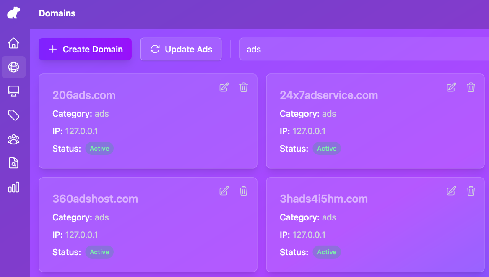
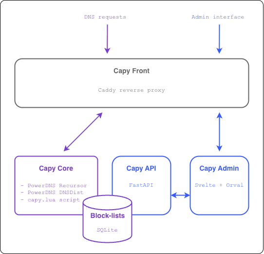
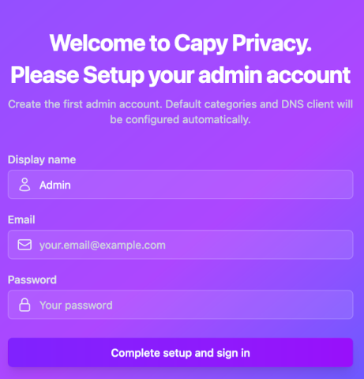
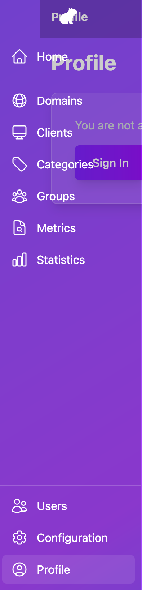

# Capy Privacy DNS

[](https://www.gnu.org/licenses/gpl-3.0)

Home DNS filtering platform with

- DNS recursive server for home devices
- DNS-over-HTTPS (DoH) for phones and Web browsers
- Single Page Application web UI + API to manage domains, clients, and blocklists



## Architecture



**Components**

| Component      | Tech stack                           | Role                                                                                |
| -------------- | ------------------------------------ | ----------------------------------------------------------------------------------- |
| **Capy Front** | Caddy                                | Publishes the API, DoH, and admin SPA. TLS termination, routing by host/path.       |
| **Admin SPA**  | Svelte + Orval SPA                   | Web UI at `admin.<domain>`; talks to the API. DoH and DNS at `dns.<domain>`.        |
| **capy-api**   | Python FastAPI                       | REST API (domains, clients, categories, stats). Feeds blocklist/config to the core. |
| **capy-core**  | DnsDist, PowerDNS Recursor, capy.lua | DoH (`/dns-query` on :5300) and DoT (:853). Applies policy and recursion.           |

## Requirements

- A homelab, home-server, NAS or Raspberry-Pi running Linux (Debian recommended)
- Docker Engine with the Compose plugin (`docker compose`)
- TLS certificates: (generated by ./prerequisites.sh)
- Host open ports 80, 443 (front); optionally 53, 853 (core)
- Internet inbound connectivity on those ports (if you want to use it in roaming)
- If you want to use from the outside (5G network or other) you will need a DNS domain

## mkcert

```
sudo apt install libnss3-tools
curl -JLO "https://dl.filippo.io/mkcert/latest?for=linux/amd64"
chmod +x mkcert-v*-linux-amd64
sudo cp mkcert-v*-linux-amd64 /usr/local/bin/mkcert
```


## Quick start (first time)

From the device that will host the services

1. **Get project sources**

Clone the capy-privacy repositiry

```bash
git clone https://github.com/capy-security/capy-privacy.git
```

2. **First-time setup**

Host CLI (stdlib Python): `./capy`

```bash
cd capy-privacy
./capy setup --domain example.com --ip 203.0.113.10
./capy ssl --email you@example.com   # certbot; ports 80/443 must be free
./capy up                            # docker compose up -d --build
./capy test
```

- **Production (real domain):** `./capy setup` then `./capy ssl` (certbot → `./deploy/ssl`).
- **Localhost / mkcert:** keep using legacy `./capy-init.sh` for now.
- /!\ On a public server, tighten `./deploy/powerdns/allow_from.yml` (and `./deploy/dnsdist/allow_from.txt`).

3. **Build and run**

```bash
./capy up          # or: sudo ./capy up   if Docker needs root for ports 53/80/443/853
```

Services bind privileged ports (`53`, `80`, `443`, `853`); `sudo` is required unless your user is in the `docker` group and you accept that trade-off.

4. **Create the first admin**



- Open the admin UI for the first time
  - e.g. `https://admin.localhost` for local; accept the self-signed cert in the browser
  - e.g. `https://your-domain/` if you specified one

- You should see the Admin creation page
- Setup an email and a password and log

5. **How to use**

After logging in, the sidebar gives access to:

- **Domains** — Add, edit or remove domains; assign them to a category and set allow/block.
- **Clients** — Manage DNS clients (devices by IP); link them to groups for filtering policy.
- **Categories** — Define blocklist categories (e.g. ads, malware) and assign domains to them.
- **Groups** — Create groups of clients and attach categories to apply filtering per group.
- **Metrics** — Browse DNS query metrics (domains, clients, blocked/allowed) with filters and search.
- **Statistics** — View aggregated DNS statistics (queries, blocks, trends).
- **Users** — Manage admin and API users (create, edit, delete; roles).
- **Configuration** — System overview: health, database size, network, setup status; clean metrics.
- **Profile** — Your account: display name and password.



## Project layout

```
capy-privacy/
├── docker-compose.yaml   # API, core, front (Docker Compose)
├── capy                  # Host CLI: setup | ssl | test | build | up | down | restart
├── capy-init.sh          # Legacy local TLS (mkcert / openssl)
├── capy-test.sh          # Legacy bash tests (prefer ./capy test)
├── api/                  # FastAPI app (baked into image)
├── core/                 # dnsdist + PowerDNS config (baked into image)
├── front/                # Caddyfile + blocked page (baked into image)
├── admin/                # SvelteKit source for the admin UI (built into front image)
└── deploy/               # Per-install data (ssl, database, ACLs, custom Caddy, www)
```

Caddy logs go to stdout/stderr — use `sudo docker compose logs -f capy-front`.
## License

This project is licensed under the [GNU GPL v3](https://www.gnu.org/licenses/gpl-3.0). See [LICENSE](LICENSE).

## Contact

Gaël Soudé — capy.security@protonmail.com
