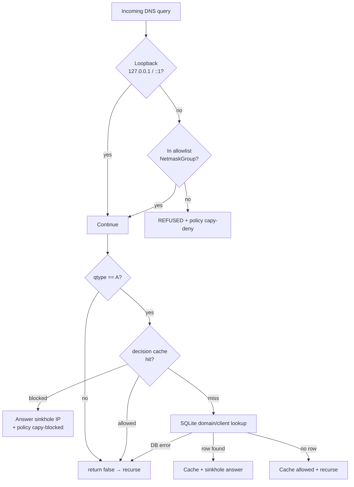

# PowerDNS Lua policy (`capy.lua`)

This document describes how the Recursor Lua script enforces DNS policy for
Capy Privacy: default-deny IP/CIDR allowlisting, category-based domain
sinkholing, in-memory caches, and protobuf metrics metadata.

**Source:** [`core/system/etc/powerdns/lua.d/capy.lua`](../core/system/etc/powerdns/lua.d/capy.lua)  
**Loaded by:** [`core/system/etc/powerdns/recursor.yml`](../core/system/etc/powerdns/recursor.yml) (`lua_dns_script`)  
**Database:** shared SQLite at `/var/capy/database/database.db` (same file as the API)

Official PowerDNS background:

- [Lua hooks (`preresolve`)](https://docs.powerdns.com/recursor/lua-scripting/hooks.html)
- [Netmasks / NetmaskGroup](https://docs.powerdns.com/recursor/lua-scripting/netmask.html)

---

## Role in the stack

```text
Client  →  dnsdist (:53 / :853 / DoH)  →  Recursor 127.0.0.1:5353  →  Internet
                                      ↑
                               Proxy Protocol
                          (real client IP preserved)
                                      ↑
                                 capy.lua
                            (preresolve hook)
```

dnsdist fronts public DNS and forwards to the Recursor with **Proxy Protocol**,
so `dq.remoteaddr` in Lua is the real client address (not `127.0.0.1`).

The script runs on every query **before** recursion (`preresolve`). It can:

1. **Refuse** the query (not on allowlist)
2. **Answer locally** with a sinkhole A record (blocked domain)
3. **Defer** to normal recursion (`return false`)

---

## High-level decision flow



---

## Entry point: `preresolve(dq)`

PowerDNS calls this for each query. Return value:

| Return | Meaning |
| --- | --- |
| `true` | Script handled the query; Recursor sends whatever was set on `dq` |
| `false` | Continue with normal recursive resolution |

```lua
function preresolve(dq)
    -- 1) allowlist check → maybe REFUSED
    -- 2) only A queries get sinkhole logic
    -- 3) cache / SQL → sinkhole or recurse
end
```

---

## 1. Default-deny allowlist (IP / CIDR)

Before any filtering, the client must be on the allowlist (`allowed_ip` table).
Entries may be a **host** (`203.0.113.10`) or a **CIDR** (`37.167.0.0/16`).

### NetmaskGroup cache

Matching uses PowerDNS `NetmaskGroup` (`newNMG` / `addMask` / `match`), not a
per-query SQL `WHERE ip = …`. The group is rebuilt from SQLite at most once
every **60 seconds** (`allow_nmg_ttl_seconds`).

| Piece | Role |
| --- | --- |
| `load_allow_nmg()` | `SELECT ip FROM allowed_ip` → `nmg:addMask(ip)` for each row |
| `get_allow_nmg()` | Return cached group, or rebuild if missing / TTL expired |
| `is_client_ip_allowed(remoteaddr)` | Loopback always allowed; else `nmg:match(remoteaddr)` |

**Why cache?** Avoid a SQLite round-trip on every DNS query.  
**Trade-off:** Portal allowlist edits can take up to ~60s to apply (or until
the next rebuild). Restarting `capy-core` reloads the script and clears the
cache immediately.

### Example: hosts + subnet

`allowed_ip` table:

| ip | reason |
| --- | --- |
| `203.0.113.10` | Home fiber |
| `37.167.0.0/16` | Mobile ISP CGNAT |

After `load_allow_nmg()`:

```text
nmg = newNMG()
nmg:addMask("203.0.113.10")    -- host → treated as /32
nmg:addMask("37.167.0.0/16")   -- entire /16
```

| Client IP | `nmg:match` | Result |
| --- | --- | --- |
| `203.0.113.10` | true | Allowed |
| `37.167.37.237` | true | Allowed (inside `/16`) |
| `37.168.0.1` | false | `REFUSED` + `capy-deny` |
| `8.8.8.8` | false | `REFUSED` + `capy-deny` |
| `127.0.0.1` | n/a | Always allowed (dnsdist / health checks) |

### TTL timeline

```text
t=0      First query → cache miss → SELECT + build nmg (expires_at = t+60)
t=1..59  Further queries → reuse same nmg (no DB)
t=30     Admin adds 37.167.0.0/16 in the portal
t=30-59  Queries still use the old nmg (new CIDR not active yet)
t=60+    Next query → rebuild → CIDR is active
```

### On deny

```lua
apply_ip_deny_policy(dq, client_ip)  -- appliedPolicy = "capy-deny"
dq.rcode = pdns.REFUSED
return true
```

Log line (debug only): `IP DENIED (not in allowlist): <ip>`.

If the DB is unavailable during reload, the script **fails closed**: an empty
NetmaskGroup denies all non-loopback clients.

---

## 2. Domain sinkholing (A queries only)

If the client is allowlisted and `dq.qtype == pdns.A`, the script may replace
the answer with a configured sinkhole IP from the `domain` table.

Other qtypes (`AAAA`, `HTTPS`, `MX`, …) skip this path and recurse normally
(`return false`).

### Domain name normalization

PowerDNS gives names with a trailing dot (`ads.example.com.`). The DB stores
names without it. The script strips the trailing dot before lookup.

### Decision cache (per client + domain)

Separate from the allowlist NetmaskGroup. Key: `"<client_ip>|<domain>"`, TTL
60s (`decision_cache_ttl_seconds`).

| Cached state | Behavior |
| --- | --- |
| `blocked` + sinkhole IP | Answer A record immediately (no SQL) |
| `allowed` | `return false` → recurse |
| miss | Run SQL, then `cache_set` |

### SQL policy (who gets blocked)

Simplified logic of the query in `preresolve`:

Block domain `D` for client IP `C` when `D` is **active** in the DB **and**:

1. **Registered client with matching group policy** — `C` exists in `client`,
   belongs to a group that includes `D`’s category; **or**
2. **Unknown client (default block)** — `C` is **not** in the `client` table
   at all → any active domain is sinkholed.

So:

- Allowlisted but **not registered** as a client → broad sinkhole for all
  active blocklist domains.
- **Registered** client → only categories linked via their groups.

### Example: sinkhole path

Tables (abbreviated):

```text
client:     id=1, ip=203.0.113.10, name=Laptop
group:      id=1, name=Home
assoc:      group 1 ↔ client 1, group 1 ↔ category "ads"
domain:     name=tracker.ads, category=ads, isactive=1, ip=127.0.0.1
allowed_ip: 203.0.113.10
```

Query: `A tracker.ads.` from `203.0.113.10`

1. Allowlist: match → continue  
2. qtype A → continue  
3. Cache miss → SQL finds the domain (client in group with `ads`)  
4. Answer: `tracker.ads. A 127.0.0.1` (or whatever `domain.ip` is)  
5. Policy: `capy-blocked`, tag `ads`  
6. Cache blocked decision for 60s  

Query: `A example.com.` from same client → no row → cache allowed → recurse.

### On block

```lua
apply_block_policy(dq, domain, category_name)
dq.rcode = 0
dq:addAnswer(pdns.A, domain_ip)  -- sinkhole
return true
```

If SQLite is down for the domain lookup, the script logs a warning and
**fails open for filtering** (`return false` → recurse). The allowlist check
still fails closed when its own reload cannot load masks.

---

## 3. Policy metadata (metrics)

Lua does not write metrics itself. It sets PowerDNS `appliedPolicy` (and
optional policy tags) on `dq`. The Recursor exports responses over protobuf;
the Go collector persists them.

| Policy name | When | Category tag |
| --- | --- | --- |
| `capy-deny` | Client not on allowlist | none |
| `capy-blocked` | Domain sinkholed | `category.name` (e.g. `ads`) |

See also [`core/resources/metrics/readme.md`](../core/resources/metrics/readme.md).

---

## 4. Database access

| Item | Value |
| --- | --- |
| Driver | LuaSQL SQLite3 (`luasql.sqlite3`) |
| Path | `/var/capy/database/database.db` |
| Connection | Global `con`, created at script load; reconnect on demand |
| Helper | `exec_sql(request)` → `(rows, error_string)` |

SQL string values are passed through `con:escape(...)` before interpolation.

Tables touched by the script:

| Table | Use |
| --- | --- |
| `allowed_ip` | Allowlist hosts/CIDRs |
| `domain` / `category` | Active sinkhole targets |
| `client` / `group` / association tables | Per-client category policy |

The API (portal) is the writer; Lua is read-mostly.

---

## 5. Logging

| Level | Examples |
| --- | --- |
| `Debug` | `IP DENIED…`, `DOMAIN:…`, `BLOCKED:…`, `CACHE …`, raw SQL |
| `Warning` | Invalid allowlist mask skipped; DB unavailable for domain lookup |
| `Error` | DB connect failure; allowlist reload / SQL execution errors |

Recursor default logging is quiet (`logging.quiet: true` in `recursor.yml`).
IP denials are **debug** so they do not flood production logs. Raise
`logging.loglevel` to debug (7) when troubleshooting.

---

## 6. Tunables (top of `capy.lua`)

| Variable | Default | Effect |
| --- | --- | --- |
| `allow_nmg_ttl_seconds` | `60` | How often the allowlist NetmaskGroup is rebuilt from DB |
| `decision_cache_ttl_seconds` | `60` | How long block/allow decisions are cached per client+domain |
| `db_path` | `/var/capy/database/database.db` | SQLite path inside the core container |

---

## 7. End-to-end scenarios

### A. Mobile phone on CGNAT (subnet allow)

1. Portal → Client IPs → **Allow IP / subnet** → `37.167.0.0/16`  
2. Within ~60s, `load_allow_nmg` adds that mask  
3. Phone at `37.167.32.187` queries `A google.com.`  
4. Allowlist match → not an active blocklist domain → recurse → real answer  

### B. Random internet scanner

1. `185.242.3.3` queries the public resolver  
2. Not in NetmaskGroup → `REFUSED`, policy `capy-deny`  
3. Debug log only; metrics collector may still record the response policy  

### C. Registered laptop hits ads category

1. Client `203.0.113.10` registered and in group “Home” with category `ads`  
2. Queries `A doubleclick.net.` (active domain, sinkhole `127.0.0.1`)  
3. SQL match → answer `127.0.0.1`, policy `capy-blocked`, tag `ads`  

### D. Allowlisted guest, not registered

1. IP allowed as host or via CIDR, but **no** `client` row  
2. Any **active** domain in the DB is sinkholed (default-block for unknowns)  
3. Domains not in the DB still recurse normally  

---

## Related docs / code

| Resource | Description |
| --- | --- |
| [`capy.lua`](../core/system/etc/powerdns/lua.d/capy.lua) | Implementation |
| [`recursor.yml`](../core/system/etc/powerdns/recursor.yml) | Loads the script, protobuf export |
| [`api/models/allowed_ip.py`](../api/src/api/models/allowed_ip.py) | API validation for IP/CIDR |
| [`core/resources/metrics/readme.md`](../core/resources/metrics/readme.md) | Protobuf collector contract |
| Admin **Client IPs** page | Manage allowlist hosts and subnets |
