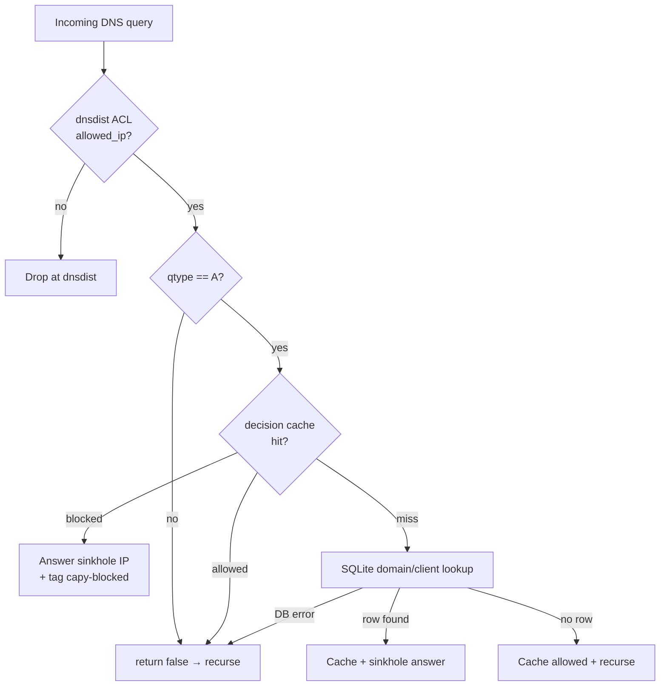

# PowerDNS Lua policy (`capy.lua`)

This document describes how the Recursor Lua script enforces DNS **domain**
policy for Capy Privacy: category-based sinkholing, in-memory decision cache,
and protobuf metrics metadata.

**IP allowlisting is not done here.** The product default-deny allowlist
(`allowed_ip` in SQLite) is enforced by **dnsdist’s in-memory ACL**, driven by
the API over the encrypted console (`addACL` / `rmACL` / `setACL`). See
[`api/src/api/dnsdist_acl.py`](../api/src/api/dnsdist_acl.py) and
[`core/system/etc/dnsdist/dnsdist.conf`](../core/system/etc/dnsdist/dnsdist.conf).

**Source:** [`core/system/etc/powerdns/lua.d/capy.lua`](../core/system/etc/powerdns/lua.d/capy.lua)  
**Loaded by:** [`core/system/etc/powerdns/recursor.yml`](../core/system/etc/powerdns/recursor.yml) (`lua_dns_script`)  
**Database:** shared SQLite at `/var/capy/database/database.db` (same file as the API)

Official PowerDNS background:

- [Lua hooks (`preresolve`)](https://docs.powerdns.com/recursor/lua-scripting/hooks.html)

---

## Role in the stack

```text
Client  →  dnsdist ACL (allowed_ip via console)  →  Recursor 127.0.0.1:5353  →  Internet
                         ↑                                    ↑
                    drop if denied                     Proxy Protocol
                                                      (real client IP)
                                                            ↑
                                                       capy.lua
                                                  (sinkhole only)
```

dnsdist fronts public DNS. Non-allowlisted clients are **dropped at dnsdist**
and never reach the Recursor. Allowed queries are forwarded with **Proxy
Protocol**, so `dq.remoteaddr` in Lua is the real client address.

The script runs on every query that reaches the Recursor **before** recursion
(`preresolve`). It can:

1. **Answer locally** with a sinkhole A record (blocked domain)
2. **Defer** to normal recursion (`return false`)

---

## High-level decision flow



---

## Entry point: `preresolve(dq)`

PowerDNS calls this for each query. Return value:

| Return | Meaning |
| --- | --- |
| `true` | Script handled the query; Recursor sends whatever was set on `dq` |
| `false` | Continue with normal recursive resolution |

```lua
function preresolve(dq)
    -- 1) only A queries get sinkhole logic
    -- 2) cache / SQL → sinkhole or recurse
end
```

---

## 1. Domain sinkholing (A queries only)

If `dq.qtype == pdns.A`, the script may replace the answer with a configured
sinkhole IP from the `domain` table.

Other qtypes (`AAAA`, `HTTPS`, `MX`, …) skip this path and recurse normally
(`return false`).

### Domain name normalization

PowerDNS gives names with a trailing dot (`ads.example.com.`). The DB stores
names without it. The script strips the trailing dot before lookup.

### Decision cache (per client + domain)

Key: `"<client_ip>|<domain>"`, TTL 60s (`decision_cache_ttl_seconds`).

| Cached state | Behavior |
| --- | --- |
| `blocked` + sinkhole IP | Answer A record immediately (no SQL) |
| `allowed` | `return false` → recurse |
| miss | Run SQL, then `cache_set` |

### SQL policy (who gets blocked)

Block domain `D` for client IP `C` when `D` is **active** in the DB **and**:

1. **Registered client with matching group policy** — `C` exists in `client`,
   belongs to a group that includes `D`’s category; **or**
2. **Unknown client (default block)** — `C` is **not** in the `client` table
   at all → any active domain is sinkholed.

So:

- Allowlisted (at dnsdist) but **not registered** as a client → broad sinkhole
  for all active blocklist domains.
- **Registered** client → only categories linked via their groups.

### Example: sinkhole path

Tables (abbreviated):

```text
client:     id=1, ip=203.0.113.10, name=Laptop
group:      id=1, name=Home
assoc:      group 1 ↔ client 1, group 1 ↔ category "ads"
domain:     name=tracker.ads, category=ads, isactive=1, ip=127.0.0.1
allowed_ip: 203.0.113.10   -- pushed to dnsdist ACL by the API
```

Query: `A tracker.ads.` from `203.0.113.10`

1. dnsdist ACL: match → forward to recursor  
2. qtype A → continue  
3. Cache miss → SQL finds the domain (client in group with `ads`)  
4. Answer: `tracker.ads. A 127.0.0.1` (or whatever `domain.ip` is)  
5. Tags: `capy-blocked`, `ads`  
6. Cache blocked decision for 60s  

Query: `A example.com.` from same client → no row → cache allowed → recurse.

### On block

```lua
apply_block_policy(dq, domain, category_name)  -- tags: capy-blocked (+ category)
dq.rcode = 0
dq:addAnswer(pdns.A, domain_ip)  -- sinkhole
return true
```

Use **`addPolicyTag` only** for metrics. Do **not** touch `dq.appliedPolicy`
(RPZ object): half-setting it while answering with `addAnswer` + `return true`
causes Recursor errors (`Attempt to print an unset DNSName`, Lua cast failures).

If SQLite is down for the domain lookup, the script logs a warning and
**fails open for filtering** (`return false` → recurse).

---

## 2. Policy metadata (metrics)

Lua does not write metrics itself. It adds protobuf **policy tags** on `dq`.
The Recursor exports responses; the Go collector maps reserved tags to
`blocked` / `applied_policy`, and category-name tags to `category_id`.

| Tag | When | Extra tags |
| --- | --- | --- |
| `capy-blocked` | Domain sinkholed | optional `category.name` (e.g. `ads`) |

Non-allowlisted clients never reach the Recursor, so there is **no**
`capy-deny` tag anymore (dnsdist drops those queries).

See also [`core/resources/metrics/readme.md`](../core/resources/metrics/readme.md).

---

## 3. Database access

| Item | Value |
| --- | --- |
| Driver | LuaSQL SQLite3 (`luasql.sqlite3`) |
| Path | `/var/capy/database/database.db` |
| Connection | Global `con`, created at script load; reconnect on demand |
| Helper | `exec_sql(request)` → `(rows, error_string)` |

SQL string values are passed through `con:escape(...)` before interpolation.

Tables touched by the script:

| Table | Use |
| --- | --- |
| `domain` / `category` | Active sinkhole targets |
| `client` / `group` / association tables | Per-client category policy |

`allowed_ip` is read by the **API** (and pushed to dnsdist), not by Lua.

The API (portal) is the writer; Lua is read-mostly for domain policy.

---

## 4. Logging

| Level | Examples |
| --- | --- |
| `Debug` | `DOMAIN:…`, `BLOCKED:…`, `CACHE …`, raw SQL |
| `Warning` | DB unavailable for domain lookup |
| `Error` | DB connect failure; SQL execution errors |

Recursor default logging is quiet (`logging.quiet: true` in `recursor.yml`).
Raise `logging.loglevel` to debug (7) when troubleshooting.

---

## 5. Tunables (top of `capy.lua`)

| Variable | Default | Effect |
| --- | --- | --- |
| `decision_cache_ttl_seconds` | `60` | How long block/allow decisions are cached per client+domain |
| `db_path` | `/var/capy/database/database.db` | SQLite path inside the core container |

---

## 6. End-to-end scenarios

### A. Mobile phone on CGNAT (subnet allow)

1. Portal → Client IPs → **Allow IP / subnet** → `37.167.0.0/16`  
2. API calls dnsdist `addACL("37.167.0.0/16")` immediately  
3. Phone at `37.167.32.187` queries `A google.com.`  
4. dnsdist ACL match → Lua: not an active blocklist domain → recurse → real answer  

### B. Random internet scanner

1. `185.242.3.3` queries the public resolver  
2. Not in dnsdist ACL → query **dropped** (no answer, no protobuf/`capy-deny`)  

### C. Registered laptop hits ads category

1. Client `203.0.113.10` registered and in group “Home” with category `ads`  
2. Queries `A doubleclick.net.` (active domain, sinkhole `127.0.0.1`)  
3. SQL match → answer `127.0.0.1`, tags `capy-blocked` + `ads`  

### D. Allowlisted guest, not registered

1. IP allowed as host or via CIDR (dnsdist ACL), but **no** `client` row  
2. Any **active** domain in the DB is sinkholed (default-block for unknowns)  
3. Domains not in the DB still recurse normally  

---

## Related docs / code

| Resource | Description |
| --- | --- |
| [`capy.lua`](../core/system/etc/powerdns/lua.d/capy.lua) | Sinkhole implementation |
| [`dnsdist.conf`](../core/system/etc/dnsdist/dnsdist.conf) | Console + boot ACL |
| [`dnsdist_acl.py`](../api/src/api/dnsdist_acl.py) | API → dnsdist console sync |
| [`recursor.yml`](../core/system/etc/powerdns/recursor.yml) | Loads the script, protobuf export |
| [`api/models/allowed_ip.py`](../api/src/api/models/allowed_ip.py) | API validation for IP/CIDR |
| [`core/resources/metrics/readme.md`](../core/resources/metrics/readme.md) | Protobuf collector contract |
| Admin **Client IPs** page | Manage allowlist hosts and subnets |
